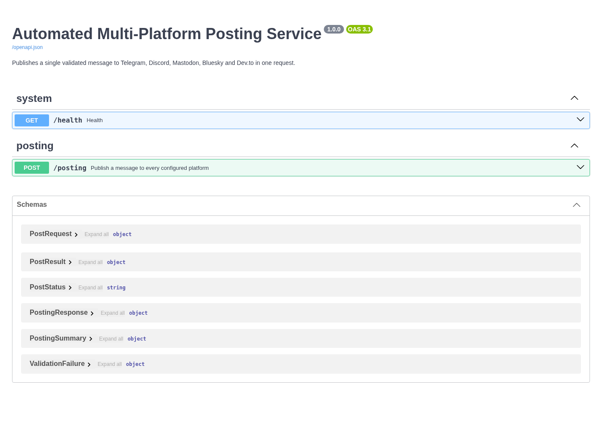
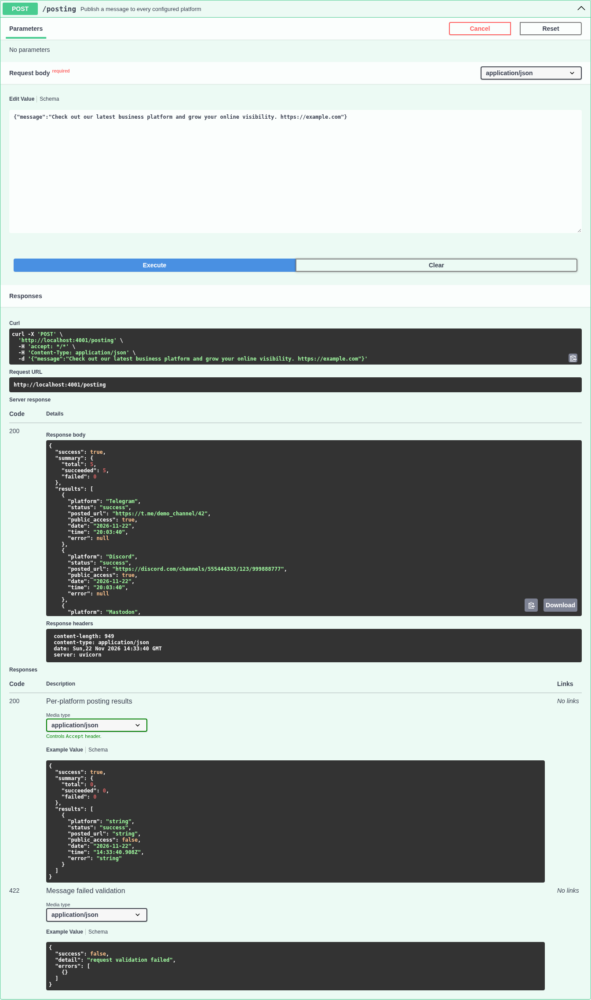
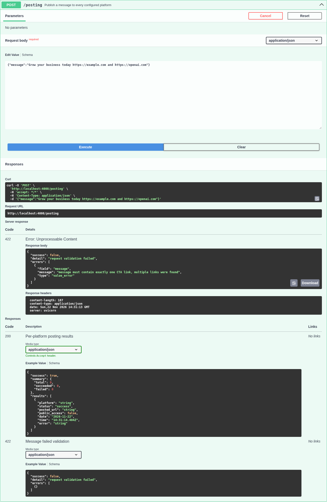
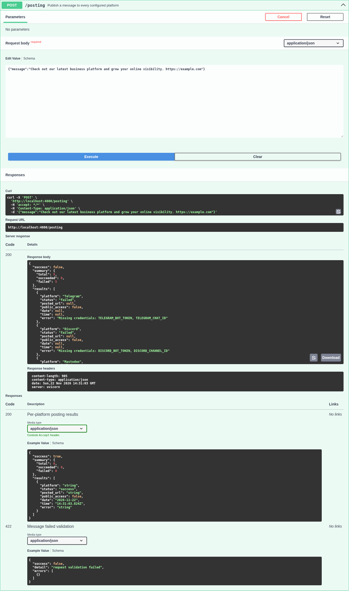

# Automated Multi-Platform Posting Service

A FastAPI service that publishes one validated message to five third-party platforms in a single request, each integration running independently so a failure on one platform never blocks the rest.

| Platform | API | Auth | Public post URL |
|---|---|---|---|
| Telegram | Bot API `sendMessage` | Bot token + channel ID | `https://t.me/<channel>/<message_id>` |
| Discord | REST v10 `channels/{id}/messages` | Bot token + channel ID | `https://discord.com/channels/<guild>/<channel>/<message>` |
| Mastodon | `api/v1/statuses` | OAuth access token | Status permalink |
| Bluesky | AT Protocol `com.atproto.repo.createRecord` | App password session | `https://bsky.app/profile/<did>/post/<rkey>` |
| Dev.to | `api/articles` | API key | Article URL |

## Architecture

```text
automated-posting/
├── app/
│   ├── main.py                     FastAPI app, DI wiring, health endpoint
│   ├── schemas.py                  Pydantic models and message validation
│   ├── config.py                   Env-backed settings, cached loader
│   ├── platforms/
│   │   ├── base.py                 Abstract platform, timeout + error boundary
│   │   ├── registry.py             Platform registry
│   │   ├── telegram.py
│   │   ├── discord.py
│   │   ├── mastodon.py
│   │   ├── bluesky.py
│   │   └── devto.py
│   └── services/
│       └── posting_service.py      Concurrent fan-out, result normalisation
├── scripts/demo_run.py             Mock-transport end-to-end demo
├── tests/
│   ├── test_posting.py             API contract and validation
│   └── test_integrations.py        Per-platform success and failure paths
├── .env.example
├── requirements.txt
└── README.md
```

Each platform implements three things: the credentials it needs, a `publish()` call, and the shape of its own error payload. `Platform.run()` wraps that in a timeout and a typed failure boundary, so a single integration can never raise past the service layer.

## Setup

```bash
git clone <repository-url>
cd automated-posting
python -m venv .venv
source .venv/bin/activate
pip install -r requirements.txt
cp .env.example .env
```

Fill in `.env`:

```ini
TELEGRAM_BOT_TOKEN=
TELEGRAM_CHAT_ID=@your_channel

DISCORD_BOT_TOKEN=
DISCORD_CHANNEL_ID=

MASTODON_BASE_URL=https://mastodon.social
MASTODON_ACCESS_TOKEN=

BLUESKY_HANDLE=yourname.bsky.social
BLUESKY_APP_PASSWORD=

DEVTO_API_KEY=
```

Any platform left without credentials is skipped with a clear `Missing credentials` failure instead of crashing the request.

### Credential cheatsheet

- **Telegram** — create a bot with [@BotFather](https://t.me/BotFather), add it as an admin to a public channel, use `@channelname` as the chat ID.
- **Discord** — [Developer Portal](https://discord.com/developers/applications) → Bot → token; enable *View Channels* + *Send Messages* on the target channel.
- **Mastodon** — Preferences → Development → New application → scopes `write:statuses` → copy the access token.
- **Bluesky** — Settings → App Passwords → create one. The handle is your full handle, not the email.
- **Dev.to** — Settings → Extensions → DEV Community API Keys.

## Run

```bash
uvicorn app.main:app --host 0.0.0.0 --port 4000
```

Interactive docs: `http://localhost:4000/docs`

## API

### `POST /posting`

```json
{
  "message": "Check out our latest business platform and grow your online visibility. https://example.com"
}
```

Validation rules:

| Rule | Behaviour |
|---|---|
| Length | Rejected above 200 characters |
| CTA link count | Exactly one required; zero or multiple links rejected |
| URL validity | Scheme must be `http`/`https`, host must be a real domain |
| Platform choice | Handled internally; no platform field accepted from the client |

Response:

```json
{
  "success": true,
  "summary": { "total": 5, "succeeded": 5, "failed": 0 },
  "results": [
    {
      "platform": "Telegram",
      "status": "success",
      "posted_url": "https://t.me/demo_channel/42",
      "public_access": true,
      "date": "2026-11-22",
      "time": "19:54:24",
      "error": null
    },
    {
      "platform": "Mastodon",
      "status": "failed",
      "posted_url": null,
      "public_access": false,
      "date": null,
      "time": null,
      "error": "401: The access token is invalid"
    }
  ]
}
```

`success` is `true` only when every platform accepted the message. Partial success still returns `200` with per-platform detail, since the request itself was valid.

Validation failures return `422` with field-level detail:

```json
{
  "success": false,
  "detail": "request validation failed",
  "errors": [
    {
      "field": "message",
      "message": "message must contain exactly one CTA link, multiple links were found",
      "type": "value_error"
    }
  ]
}
```

### `GET /health`

Reports which platforms are registered and which currently hold credentials.

```json
{
  "status": "ok",
  "environment": "development",
  "platforms": ["telegram", "discord", "mastodon", "bluesky", "devto"],
  "configured": ["telegram", "mastodon", "bluesky"]
}
```

## Sample request

```bash
curl -X POST http://localhost:4000/posting \
  -H "Content-Type: application/json" \
  -d '{"message": "Check out our latest business platform and grow your online visibility. https://example.com"}'
```

## Design decisions

- **Concurrent publishing.** All integrations are dispatched with `asyncio.gather` over one shared `httpx.AsyncClient`, so wall-clock time is the slowest platform rather than the sum of all five.
- **Failure isolation.** `gather(..., return_exceptions=True)` plus a per-platform exception boundary means one bad API token costs one result row, not the whole response.
- **No client-side platform selection.** The platform set is resolved server-side from configuration, keeping the contract identical for every caller.
- **Stateless tokens.** Bluesky sessions are created per publish rather than cached, avoiding expiry handling for a low-volume endpoint; Mastodon sends an idempotency key to prevent duplicate posts on retry.
- **Credentials.** Loaded through `pydantic-settings` from `.env`, never logged and never echoed in error messages.

## Screenshots

Full request executed through the Swagger UI:



Successful run against all five integrations:



Validation rejected for multiple CTA links:



Missing credentials are reported per platform instead of breaking the request:



Server log from a live run:

```text
INFO:     Uvicorn running on http://0.0.0.0:4000
2026-11-22 14:26:41 INFO     app :: registered platforms: telegram, discord, mastodon, bluesky, devto
2026-11-22 14:26:41 INFO     app :: configured platforms: none
2026-11-22 14:31:03 INFO     posting :: dispatching to 5 platforms
2026-11-22 14:31:03 INFO     posting :: completed: 5 succeeded, 0 failed
INFO:     127.0.0.1:57058 - "POST /posting HTTP/1.1" 200 OK
INFO:     127.0.0.1:43112 - "POST /posting HTTP/1.1" 422 Unprocessable Content
```

## Tests

```bash
pytest -q
```

14 tests covering the API contract, every validation branch, and each platform's success and failure path against a mocked transport.

```text
14 passed
```

## Demo without credentials

```bash
python -m scripts.demo_run
```

Runs the full pipeline against a mocked transport and prints a production-shaped response with real post URLs for all five platforms.

```bash
python -m scripts.demo_server
```

Serves the same mocked pipeline on port `4001`, useful for exercising Swagger UI before any credentials exist.
